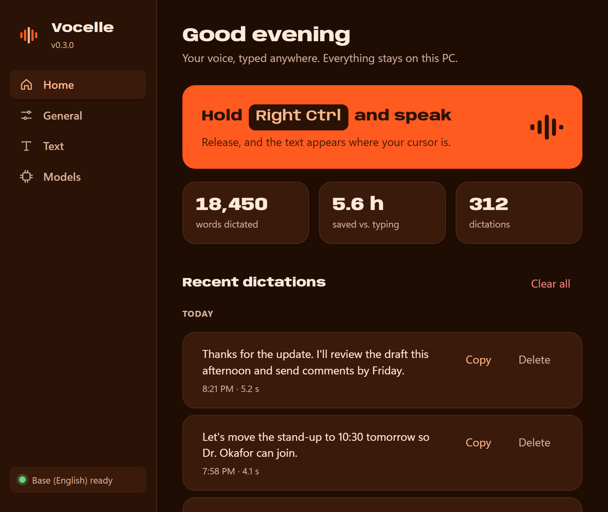
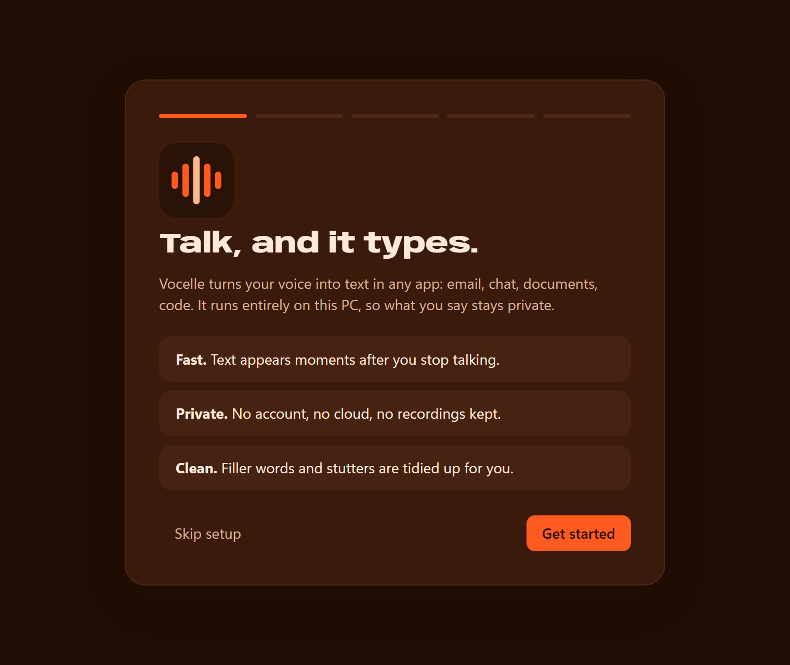
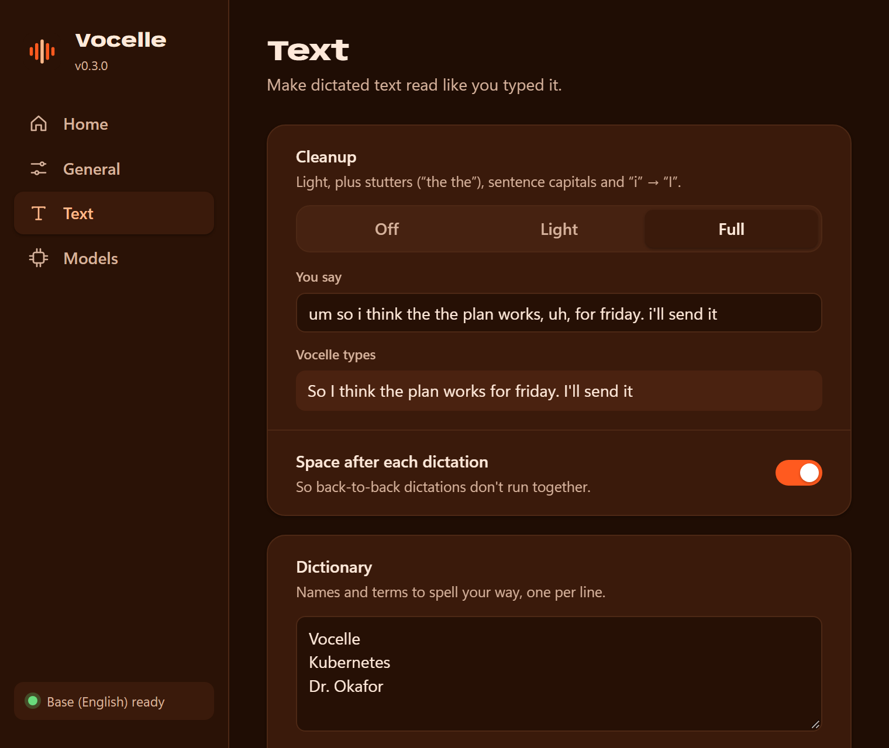
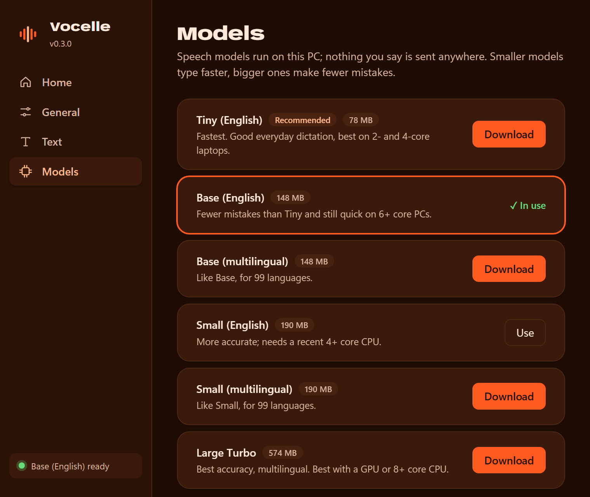
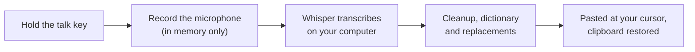

<p align="center">
  
</p>

<p align="center">
  <strong>Private, offline voice dictation for Windows and Linux.</strong><br>
  Hold a key, speak, and your words appear in any app, transcribed on your own computer.
</p>

<p align="center">
  <a href="https://github.com/codewithdark-git/vocelle/releases/latest"></a>
  <a href="https://github.com/codewithdark-git/vocelle/actions/workflows/ci.yml"></a>
  
  <a href="LICENSE"></a>
</p>

<p align="center">
  <a href="https://github.com/codewithdark-git/vocelle/releases/latest"><b>Download</b></a>
  ·
  <a href="https://codewithdark-git.github.io/vocelle/">Website</a>
  ·
  <a href="#quick-start">Quick start</a>
  ·
  <a href="#using-vocelle">Using Vocelle</a>
  ·
  <a href="#troubleshooting">Troubleshooting</a>
  ·
  <a href="CHANGELOG.md">What's new</a>
</p>

---

## Why Vocelle

- **Works offline.** Speech recognition runs on your computer with open-source Whisper models. No account, no internet needed after the model download.
- **Private by design.** Your audio never leaves your computer. No screenshots, no telemetry.
- **Types anywhere.** Word, Chrome, Slack, Teams, VS Code, Notepad: if an app has a text cursor and accepts paste, Vocelle can type into it.
- **Reads like you typed it.** Filler words, stutters and spacing are cleaned up, and your dictionary gets names right.
- **Stays out of the way.** A small tray app with a floating indicator that never steals focus.

## Screenshots

<table>
  <tr>
    <td width="50%"></td>
    <td width="50%"></td>
  </tr>
  <tr>
    <td align="center"><b>Home</b>: your stats and recent dictations</td>
    <td align="center"><b>Welcome</b>: a two-minute guided setup</td>
  </tr>
  <tr>
    <td></td>
    <td></td>
  </tr>
  <tr>
    <td align="center"><b>Text</b>: cleanup with live preview, dictionary</td>
    <td align="center"><b>Models</b>: download and switch, all local</td>
  </tr>
</table>

While you dictate, a small pill above the taskbar shows what's happening without any text: bars that move with your voice while listening, a wave of dots while transcribing, then a check mark.

## How it works



Everything in this chain runs on your computer. Voice detection skips silence, so a key press without speech types nothing.

## Features

| | |
|---|---|
| ⚡ **Fast** | Long dictations are transcribed while you're still talking, so text appears moments after you let go. |
| 🎙️ **Your talk key** | Hold to talk, release to type. Right Ctrl by default; pick Caps Lock, an F-key and more. |
| 🧠 **Local Whisper models** | Six models from Tiny (78 MB) to Large Turbo (574 MB). Vocelle recommends one for your computer. |
| ✨ **Text cleanup** | Removes "um" and "uh", fixes stutters, spacing and capitals. Three levels, with a live preview. |
| 📖 **Dictionary and replacements** | Teach Vocelle names and jargon, and set rules like "vocel" → "Vocelle". |
| 🏠 **Home** | Words dictated, time saved, and your last 200 dictations by day, text only and stored on your computer. Copy or delete any of them, or turn history off. |
| 📋 **Clipboard safe** | Whatever you had copied (text, images, files, formatting) is put back after each dictation. |
| 🤫 **Voice detection** | Silence and background noise aren't typed. |
| 🌍 **21 languages** | Automatic language detection with multilingual models, or pick one. |
| 🔒 **Verified downloads** | Models come from the official whisper.cpp repositories and are checked with SHA-256. |

## System requirements

| | Windows | Linux (preview) |
|---|---|---|
| OS | Windows 10 (1903+) or 11, 64-bit | x86-64 desktop with an **X11** session (Ubuntu 22.04+, Debian 12+, Fedora, Arch…) |
| CPU | AVX2: Intel 4th gen (2013) or newer, AMD Ryzen or newer | Same |
| Memory | 4 GB (8 GB for the larger models) | Same |
| Disk | ~200 MB with a small model, up to 800 MB with the largest | Same |

And a microphone.

## Quick start

1. **Download** from the [latest release](https://github.com/codewithdark-git/vocelle/releases/latest):
   - **Windows:** `Vocelle_x.y.z_x64-setup.exe`, then run it.
     > The installer isn't code-signed yet, so Windows may show *"Windows protected your PC"*. Click **More info → Run anyway**.
   - **Debian / Ubuntu:** `Vocelle_x.y.z_amd64.deb`, then `sudo apt install ./Vocelle_x.y.z_amd64.deb`.
   - **Other Linux:** `Vocelle_x.y.z_amd64.AppImage`, then `chmod +x Vocelle_*.AppImage` and run it.
2. **Follow the welcome setup.** On first launch Vocelle walks you through five short steps: check your microphone, download the speech model recommended for your computer, pick your talk key, and try a dictation.
3. **Dictate anywhere.** Click into any text box, **hold Right Ctrl**, speak, and **release**. Your text appears at the cursor.

Vocelle keeps running in the system tray (the orange sound-wave icon). Click it to open the app again; you can rerun the setup from **General → Setup guide**.

## Using Vocelle

### Talk key

On the **General** tab, choose a key from the list or click **Press a key…** and press the one you want. The change applies immediately.

Hold the key while you speak and release it when you're done. Pressing another key while holding it (for example Right Ctrl+C) cancels, so normal shortcuts keep working. A quick tap is ignored, and recordings stop on their own after 5 minutes.

Keys you can use: Right Ctrl, Left Ctrl, Right Shift, Caps Lock, Scroll Lock, Pause, Insert and F1–F12 (plus Menu and F13–F24 on Windows). Letters, digits and Space can't be used, because holding them would type characters. On Windows, a non-modifier talk key such as Caps Lock is reserved for Vocelle, so it won't also toggle caps.

### Text cleanup

On the **Text** tab:

| Level | What it does | Example: *"um so i think the the plan works, uh, for friday"* |
|---|---|---|
| Off | Inserts exactly what the model heard | um so i think the the plan works, uh, for friday |
| Light (default) | Removes "um", "uh" and similar; fixes spacing; capitalizes the first letter | So i think the the plan works for friday |
| Full | Light, plus stutters, sentence capitals and a lone "i" | So I think the plan works for friday |

Type in **Try it** to preview any level. Vocelle also adds a space after each dictation so back-to-back dictations don't run together; you can turn that off.

### Dictionary and replacements

- **Dictionary:** one name or term per line (for example *Kubernetes* or *Dr. Okafor*). These are given to the speech model as spelling hints.
- **Replacements:** whole-word rules applied to every dictation, not case-sensitive. Use them for words the model keeps getting wrong, or for shortcuts such as *"my email"* → *you@example.com*.

### Home and history

**Home** shows how many words you've dictated, roughly how much time that saved compared with typing at 40 words a minute, and your last 200 dictations grouped by day with the time and length of each. **Copy** puts one back on the clipboard; **Delete** or **Clear all** removes them. Turn history off on the General tab. Audio is never saved, only the final text.

## Choosing a model

| Model | Size | Languages | Best for |
|---|---|---|---|
| Tiny (English) | 78 MB | English | Fastest, a little less accurate; best for slow or older PCs |
| **Base (English)** | 148 MB | English | Accurate and quick on most laptops; the best place to start |
| Base (multilingual) | 148 MB | 99 languages | Like Base, for other languages |
| Small (English) | 190 MB | English | Higher accuracy on a recent 4+ core CPU |
| Small (multilingual) | 190 MB | 99 languages | Like Small, for other languages |
| Large Turbo | 574 MB | 99 languages | Best accuracy; 8+ core CPU |

English-only models are faster and more accurate for English, and always transcribe English. You can download several and switch with **Use** on the Models tab.

## Configuration

Everything is set in the app, which saves automatically. The files live here:

| What | Windows | Linux |
|---|---|---|
| Settings | `%APPDATA%\com.codewithdark.vocelle\settings.json` | `~/.config/com.codewithdark.vocelle/settings.json` |
| Log (timings only) | `%LOCALAPPDATA%\com.codewithdark.vocelle\vocelle.log` | `~/.local/share/com.codewithdark.vocelle/vocelle.log` |
| History and totals | `%LOCALAPPDATA%\com.codewithdark.vocelle\history.json`, `stats.json` | `~/.local/share/com.codewithdark.vocelle/history.json`, `stats.json` |
| Models | `%LOCALAPPDATA%\com.codewithdark.vocelle\models\` | `~/.local/share/com.codewithdark.vocelle/models/` |

<details>
<summary><b>settings.json reference</b></summary>

```json
{
  "model": "base.en",
  "talk_key": "ControlRight",
  "microphone": null,
  "language": "auto",
  "cleanup": "light",
  "trailing_space": true,
  "dictionary": ["Vocelle", "Kubernetes"],
  "replacements": [{ "from": "vocel", "to": "Vocelle" }],
  "history": true,
  "onboarded": true
}
```

| Key | Values | Default |
|---|---|---|
| `model` | `tiny.en`, `base.en`, `base`, `small.en-q5_1`, `small-q5_1`, `large-v3-turbo-q5_0` | none until you download a model |
| `talk_key` | A key code: `ControlRight`, `ControlLeft`, `ShiftRight`, `CapsLock`, `ScrollLock`, `Pause`, `Insert`, `ContextMenu`, `F1`–`F24` | `ControlRight` |
| `microphone` | A device name from the Settings list, or `null` for the system default | `null` |
| `language` | `auto` or a language code (`en`, `es`, `fr`, `de`, `hi`, `ur`, `zh`, `ja`…) | `auto` |
| `cleanup` | `off`, `light`, `full` | `light` |
| `trailing_space` | `true`, `false` | `true` |
| `dictionary` | List of words and phrases | `[]` |
| `replacements` | List of `{ "from": "…", "to": "…" }` | `[]` |
| `history` | `true`, `false` | `true` |
| `onboarded` | `true` once the welcome setup is finished or skipped | `false` |

Missing keys get their defaults, so older settings files keep working. Edit the file only while Vocelle is closed; it's read at start-up.
</details>

## Privacy

- Audio is recorded only while you dictate, is processed in memory, and is never saved to disk.
- Transcription runs entirely on your computer. The only network requests Vocelle makes are the model downloads you start in Settings, from `huggingface.co`.
- History stores text only, on your computer, and can be turned off or cleared. The Home totals are just counts (dictations, words, seconds).
- On Windows, dictated text is kept out of clipboard history (Win+V) and cloud clipboard sync.
- No accounts, analytics or telemetry.

## Troubleshooting

<details>
<summary><b>Nothing happens when I press the talk key</b></summary>

- Make sure Vocelle is running (look for the tray icon).
- Open Vocelle and check that the bottom of the sidebar shows the model as *ready*.
- Check which key and mode are set on the General tab.
- Some keyboards and remote-desktop tools remap Right Ctrl. Try Caps Lock or an F-key instead.
</details>

<details>
<summary><b>Linux: the talk key does nothing</b></summary>

Vocelle listens for the talk key through X11. On a Wayland session, desktop security doesn't let apps see global key presses. Log in with an "Xorg" or "X11" session (choose it on the login screen). The `.deb` package installs the needed X11 libraries; for the AppImage, make sure `libxtst6` is installed.
</details>

<details>
<summary><b>"Can't type into an app running as administrator" (Windows)</b></summary>

Windows blocks normal apps from typing into apps that run as administrator. Either run that app normally, or start Vocelle as administrator too.
</details>

<details>
<summary><b>"No speech heard"</b></summary>

Vocelle didn't detect speech. Pick the right microphone on the General tab and speak a little closer to it.
</details>

<details>
<summary><b>A name keeps coming out wrong</b></summary>

Add it to the **Dictionary** on the Text tab. If it still comes out wrong, add a **Replacement** from what Vocelle types to what you want.
</details>

<details>
<summary><b>Transcription is slow</b></summary>

- On a laptop, plug in the charger or choose **Best performance** in Windows *Settings → System → Power*. On battery, Windows can slow the processor to a third of its speed, and dictation slows down with it.
- Switch to *Tiny (English)*, the fastest model. Home suggests this when recent dictations were slow.
- Close CPU-heavy apps (video rendering, games, many browser tabs).
- Each dictation's timings are written to `vocelle.log` (see [Configuration](#configuration)). The log never contains what you said.
</details>

<details>
<summary><b>Vocelle closes when loading a model or dictating</b></summary>

Your CPU may not support AVX2 (see [System requirements](#system-requirements)). Support for older CPUs is planned.
</details>

<details>
<summary><b>Linux: nothing appears in a terminal</b></summary>

Vocelle pastes with Ctrl+V, but most Linux terminals paste with Ctrl+Shift+V. Dictate into another app for now; terminal support is planned.
</details>

## Updating

Download the newer installer from [Releases](https://github.com/codewithdark-git/vocelle/releases/latest) and run it over the installed version (Windows), or install the new `.deb` or AppImage the same way as before. Your settings, history and downloaded models are stored outside the app folder, so they carry over. Automatic updates are planned.

## FAQ

<details>
<summary><b>Does Vocelle need an internet connection?</b></summary>

Only to download a speech model the first time. After that it works fully offline.
</details>

<details>
<summary><b>Does it send my voice or text anywhere?</b></summary>

No. Recording, transcription and cleanup all happen on your computer. See [Privacy](#privacy).
</details>

<details>
<summary><b>Which model should I use?</b></summary>

Start with the one marked *Recommended*: Vocelle picks it for speed on your computer. If dictation feels slow, try a smaller model; if words come out wrong, try a bigger one. English-only models are the better choice when you only dictate in English.
</details>

<details>
<summary><b>Can I dictate in other languages?</b></summary>

Yes. Download a multilingual model (Base, Small or Large Turbo) and choose the language on the General tab, or leave it on automatic detection.
</details>

<details>
<summary><b>Does it work with a GPU?</b></summary>

Official builds use the CPU, which is fast enough for everyday dictation with Base or Small. GPU builds are possible from source (see [Development](#development)); GPU support in official builds is planned.
</details>

<details>
<summary><b>Is there a macOS version?</b></summary>

Not yet. Vocelle supports Windows, with Linux as a preview.
</details>

## Uninstall

- **Windows:** *Settings → Apps → Installed apps → Vocelle → Uninstall.*
- **Debian / Ubuntu:** `sudo apt remove vocelle`
- **AppImage:** delete the file.

To also remove downloaded models, history and settings, delete the folders listed under [Configuration](#configuration).

## Roadmap

- **Next:** optional AI rewriting (local or with your own API key), spoken commands like "new line", per-app styles.
- **Later:** signed installer with automatic updates, support for CPUs without AVX2, GPU acceleration.

See [CHANGELOG.md](CHANGELOG.md) for what's in each release.

---

## Development

Build instructions, architecture and test hooks are in [docs/DEVELOPMENT.md](docs/DEVELOPMENT.md). Releases follow [docs/RELEASING.md](docs/RELEASING.md). To report a security problem, see [SECURITY.md](SECURITY.md).

## License

Vocelle is proprietary software. You may download and use official releases; the source is published for transparency only. See [LICENSE](LICENSE). Bundled open-source components keep their own licenses.
