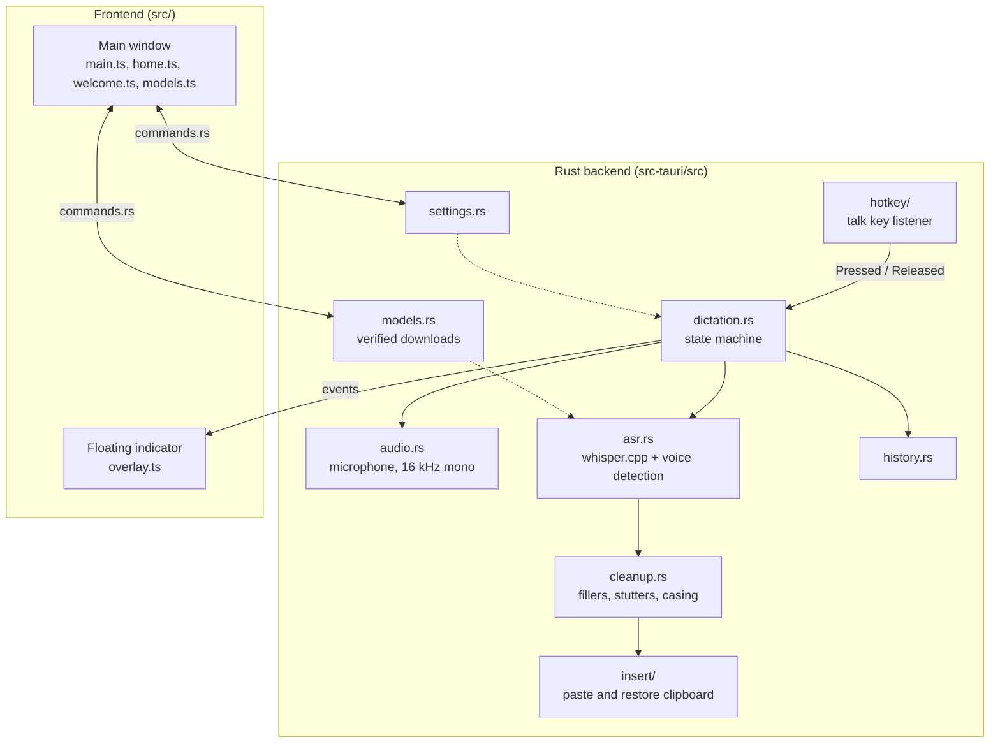

# Developing Vocelle

Vocelle is a [Tauri 2](https://tauri.app/) app: a Rust backend that records,
transcribes and types, and a small TypeScript + Vite frontend for the main window
(Home, settings and the welcome setup) and the floating indicator.

- [Requirements](#requirements)
- [Run, check and build](#run-check-and-build)
- [How the app fits together](#how-the-app-fits-together)
- [Project layout](#project-layout)
- [Testing](#testing)
- [Releasing](#releasing)

## Requirements

### Windows

- Rust stable (MSVC toolchain)
- Visual Studio 2022 Build Tools with *Desktop development with C++* (includes
  CMake and the Windows SDK)
- LLVM, used to generate the whisper.cpp bindings: `winget install LLVM.LLVM`.
  The build looks in `C:\Program Files\LLVM\bin`; set `LIBCLANG_PATH` to use
  another location.
- Node.js 22+ and npm

### Linux (Debian/Ubuntu package names)

```bash
sudo apt install build-essential cmake libclang-dev libwebkit2gtk-4.1-dev \
  libayatana-appindicator3-dev librsvg2-dev libxdo-dev libssl-dev \
  libasound2-dev libxtst-dev libx11-dev
export LIBCLANG_PATH="$(dirname "$(ls /usr/lib/llvm-*/lib/libclang.so* | head -1)")"
```

## Run, check and build

```bash
npm install
npm run tauri dev        # run with hot reload
npm run check            # formatting, clippy, unit tests, type check (same as CI)
```

Build installers:

```bash
npm run tauri build -- --bundles nsis            # Windows
npm run tauri build -- --bundles deb,appimage    # Linux
```

Output goes to `src-tauri/target/release/bundle/`. For GPU transcription, add
`--features vulkan` (needs the Vulkan SDK).

whisper.cpp is compiled for an AVX2 baseline (see `src-tauri/.cargo/config.toml`),
so a build behaves the same no matter which machine produced it.

## How the app fits together



A dictation goes through these steps:

1. **Talk key.** `hotkey/` installs a low-level keyboard hook on Windows
   (`WH_KEYBOARD_LL`) or listens through X11 XRecord on Linux. It sends
   `Pressed`, `Released` or `Interrupted` (another key was pressed while holding,
   so the user meant a shortcut such as Right Ctrl+C).
2. **Recording.** `audio.rs` captures the chosen microphone with cpal and
   resamples it to 16 kHz mono in memory. Nothing is written to disk.
3. **Transcribing ahead.** While the key is held, `dictation.rs` checks the
   audio every 0.8 s. Once 3 s or more is untranscribed, voice detection finds
   a pause between phrases and the part before it is transcribed in the
   background. On release only the rest is left, so long dictations finish
   about as fast as short ones.
4. **Transcription.** `asr.rs` keeps the model, one reusable Whisper state and
   the Silero voice detector loaded, and warms them up at load. Voice
   detection trims silence (and skips Whisper when nobody spoke); the encoder
   window is sized to the clip, with a floor of 384 frames because smaller
   windows make Whisper repeat itself. Flash attention is on, threads are all
   logical cores up to 8, and output is capped relative to the clip length.
   A sentence repeated back to back is dropped. Dictionary words go into the
   initial prompt.
5. **Cleanup.** `cleanup.rs` applies replacements, then the chosen cleanup level.
6. **Insertion.** `insert/` takes a snapshot of the whole clipboard, pastes the
   text with Ctrl+V, and puts the snapshot back. On Windows the dictated text is
   marked so it stays out of clipboard history and cloud sync. If the clipboard
   is busy or too large to copy, the text is typed instead. Steps 4–6 run on
   a finishing thread, one dictation at a time, so the talk key stays
   responsive and text always lands in the order it was spoken.

## Project layout

```
src/                    Main window and overlay UI (TypeScript + Vite)
  main.ts               Tabs, General and Text pages, auto-save
  home.ts               Home: totals and recent dictations
  welcome.ts            First-run welcome setup
  models.ts             Models page
  fonts/                Anybody display font (SIL OFL)
  api.ts                Typed backend commands
src-tauri/src/
  hotkey/               Talk key listener (Windows hook, Linux X11)
  insert/               Pasting with clipboard preservation (Windows, Linux)
  audio.rs              Microphone capture, resampled to 16 kHz mono
  asr.rs                whisper.cpp transcription with voice detection
  cleanup.rs            Filler, stutter, spacing and casing cleanup
  dictation.rs          Key → record → transcribe → clean up → insert
  history.rs            Recent dictations and Home totals
  keys.rs               Talk key catalog
  models.rs             Model catalog and verified downloader
  settings.rs           settings.json with validation
  commands.rs, speech.rs  Commands for the main window
  overlay.rs, tray.rs   Floating indicator and tray icon
assets/                 Logo files and README screenshots
site/                   Website (static HTML, deployed to GitHub Pages)
scripts/                Version and release-notes helpers
docs/                   Developer and release documentation
```

## Testing

**Unit tests** run with `npm run check` (or `cargo test` in `src-tauri`). They
cover cleanup, settings validation, the key catalog and model handling.

**Transcription against WAV files** (16 kHz mono):

```bash
cd src-tauri
VOCELLE_TEST_MODEL=path/to/ggml-base.en.bin VOCELLE_TEST_WAV="a.wav;b.wav" \
  cargo test transcribe_wav_files -- --ignored --nocapture
```

**End-to-end test hooks** (debug builds only; release builds ignore them):

- `VOCELLE_TEST_INJECTED_KEYS=1` accepts a talk key sent with `SendInput`
  (Windows), so a script can press it.
- `VOCELLE_TEST_AUDIO=clip.wav` uses a 16 kHz mono 16-bit WAV instead of the
  microphone.

- `VOCELLE_TEST_DICTATE=<ms>` holds the talk key for that long once the
  model is ready, without touching the real keyboard.
- `VOCELLE_TEST_NO_INSERT=1` logs the final text instead of pasting it.

Test audio arrives in real time, like a microphone, so transcribing ahead
behaves as it would with real speech. With `VOCELLE_TEST_DICTATE`,
`VOCELLE_TEST_AUDIO` and `VOCELLE_TEST_NO_INSERT` together, a whole dictation
runs without sending key presses or typing into whatever app has focus; the
log shows timings and `finished in … ms after release`.

To test insertion too, use `VOCELLE_TEST_INJECTED_KEYS=1` with a script that
focuses a throwaway text box and presses the talk key.

## Releasing

See [RELEASING.md](RELEASING.md).
